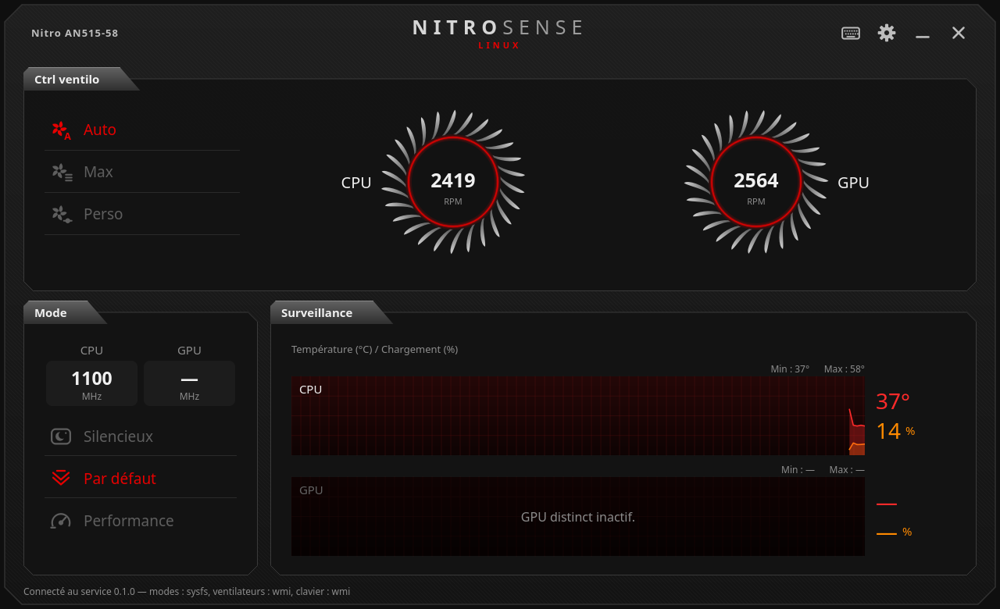
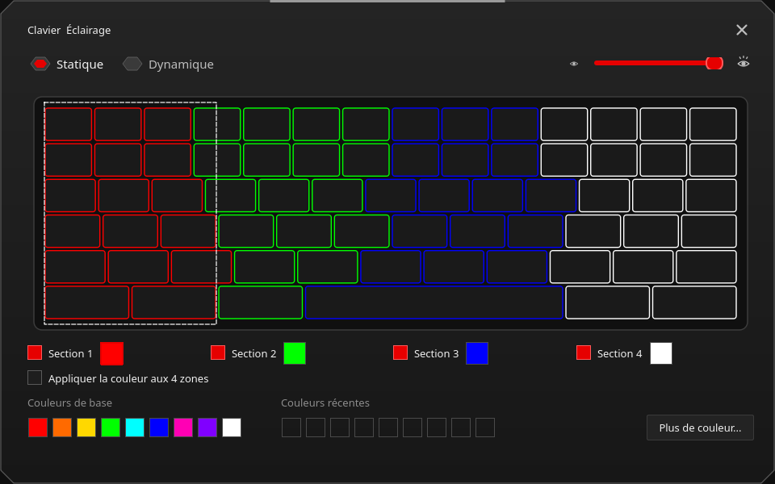
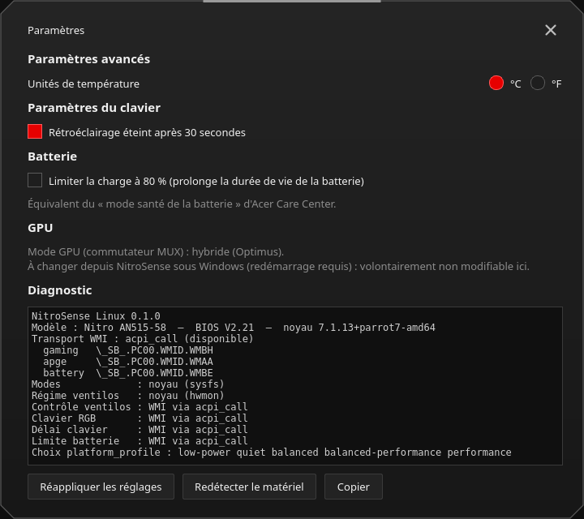

# NitroSense Linux

Équivalent de l'application **Acer NitroSense** pour Linux, pour l'**Acer Nitro 5 AN515-58** :
ventilateurs, modes de performance, éclairage RGB du clavier, limite de charge de la batterie.

> **Projet personnel non officiel, sans lien avec Acer.** Il envoie des commandes au BIOS du PC
> (les mêmes que NitroSense 3.1 sous Windows). Il a été testé sur un seul modèle : utilisation à vos risques.

## Fonctions

| Fonction | Comme NitroSense | Passe par |
|---|---|---|
| Modes Silencieux / Par défaut / Performance | oui (Performance seulement sur secteur, ≥ 40 % de batterie) | `platform_profile` du noyau, sinon WMI |
| Mode Turbo (proposé par KDE, pas par NitroSense) | conservé s'il est choisi ailleurs ; `nitrosense-cli profile turbo` | `platform_profile` |
| Ventilateurs Auto / Max / Perso (CPU et GPU, case Auto par ventilateur) | oui (désactivé en Silencieux) | WMI via `acpi_call`, sinon pwm du noyau (≥ 6.18) |
| Régime des ventilateurs, températures, charge, fréquences | oui, avec courbes et min / max | hwmon (`acer`, `coretemp`), `nvidia-smi`, sinon WMI |
| Clavier RGB 4 zones : statique, respiration, onde, zoom, déplacement, néon | oui | WMI via `acpi_call` |
| Extinction du clavier après 30 s | oui | WMI via `acpi_call` |
| Limite de charge à 80 % (Acer Care Center) | en plus | `charge_control_end_threshold`, sinon WMI |
| Mode GPU (MUX) | affiché seulement | WMI (lecture) |
| Sécurité thermique : en Perso, retour en Auto si CPU ≥ 92 °C ou GPU ≥ 87 °C | en plus | |
| Réglages réappliqués au démarrage et après la veille | oui | service systemd |

Non repris : son DTS, Planet9, overclocking GPU, changement du MUX (à faire depuis Windows).

| Éclairage du clavier | Paramètres |
|---|---|
|  |  |

## Matériel testé

| | |
|---|---|
| PC | Acer Nitro 5 AN515-58 (i5-12450H, RTX 4060 Laptop, clavier RGB 4 zones), BIOS V2.21 |
| Système | Parrot Security 7.4 (base Debian 13), KDE Plasma sous X11, noyau 7.1.13 |
| Modules | `acpi-call-dkms` 1.2.2, pilote NVIDIA 550.163.01 + `nvidia-powerd` |

Toutes les fonctions ont été vérifiées sur ce PC : modes, ventilateurs, effets du clavier (à l'œil),
extinction après 30 s, limite de charge, interface, mise en veille. Détails et mesures :
[docs/REVERSE_ENGINEERING.md](docs/REVERSE_ENGINEERING.md).

D'autres Nitro / Predator récents utilisent probablement la même interface, mais les écritures
sont bloquées par défaut sur un autre modèle (voir [Sécurité](#sécurité)).

## Installation

1. Dépendances :
   - Debian / Ubuntu / Parrot : `sudo apt install python3 python3-pyqt6 acpi-call-dkms`
   - Fedora : `sudo dnf install python3 python3-pyqt6 dkms kernel-devel`, puis acpi_call depuis
     https://github.com/nix-community/acpi_call (DKMS)
   - Arch : `sudo pacman -S python python-pyqt6 acpi_call-dkms` (ou `acpi_call` pour le noyau `linux`)
   - Avec Secure Boot actif, le module DKMS doit être signé (clé MOK à enrôler au redémarrage).
2. Vérifier que le noyau expose les modes : `cat /sys/firmware/acpi/platform_profile_choices`.
   Si le fichier est absent : `sudo modprobe -r acer_wmi && sudo modprobe acer_wmi predator_v4=1`,
   et si ça marche, installer avec `--predator-v4` pour le rendre permanent.
3. Installer :

       git clone https://github.com/SofianeGh/nitrosense-linux.git
       cd nitrosense-linux
       sudo bash install.sh            # ou : sudo bash install.sh --predator-v4

4. Lancer « NitroSense Linux » depuis le menu des applications, ou `nitrosense`.

Désinstaller : `sudo bash uninstall.sh` (ajouter `--purge` pour effacer aussi la configuration).

### Pour que le mode Performance débride la carte graphique

Le mode Performance monte la courbe des ventilateurs et, comme sous Windows, autorise la RTX 4060
à consommer plus (105 W en Par défaut → 140 W en Performance). Sous Linux, cette seconde partie
demande le service NVIDIA **`nvidia-powerd`** (Dynamic Boost). Sur Debian / Parrot, prendre la
même version que le pilote ; le paquet ne fournit le service qu'en exemple, et le programme est
dans `/usr/sbin` :

    sudo apt install nvidia-powerd=<version du pilote>
    sed 's#/usr/bin/nvidia-powerd#/usr/sbin/nvidia-powerd#' /usr/share/doc/nvidia-powerd/examples/nvidia-powerd.service \
        | sudo tee /etc/systemd/system/nvidia-powerd.service >/dev/null
    sudo install -m 644 /usr/share/doc/nvidia-powerd/examples/nvidia-dbus.conf /etc/dbus-1/system.d/
    sudo systemctl daemon-reload && sudo systemctl enable --now nvidia-powerd

Côté CPU, le mode Par défaut donne déjà la fréquence maximale sous Linux.

## Utilisation

L'interface reprend celle de NitroSense : ventilateurs en haut, modes à gauche, courbes de
température et de charge à droite, éclairage du clavier et paramètres en haut à droite.
Les réglages sont enregistrés et réappliqués au démarrage et après la veille.

En ligne de commande :

    nitrosense-cli status
    nitrosense-cli selftest                       # lecture seule de toutes les interfaces
    nitrosense-cli profile quiet|default|performance|turbo
    nitrosense-cli fan auto|max
    nitrosense-cli fan custom --cpu 60 --gpu 70 [--cpu-auto] [--gpu-auto]
    nitrosense-cli kb static --zones FF0000,00FF00,0000FF,FFFFFF --brightness 75
    nitrosense-cli kb effect wave --speed 5 --direction left --color 00FFFF
    nitrosense-cli kb off
    nitrosense-cli backlight-timeout on|off
    nitrosense-cli battery-limit on|off
    sudo nitrosense-cli raw gaming 5 01020000     # appel WMI brut (root) : régime du ventilateur CPU

Réglages avancés : `/etc/nitrosense/config.json` (utilisateurs autorisés, règles du mode
Performance, seuils de la sécurité thermique…), puis `sudo systemctl restart nitrosensed`.

## Fonctionnement

- `nitrosensed` : service root (systemd), seul à toucher le matériel. Socket `/run/nitrosense/nitrosense.sock`,
  accès limité aux utilisateurs de `allowed_users` (`/etc/nitrosense/config.json`) ou, si la liste est vide,
  aux membres de `sudo` / `wheel` / `admin`.
- `nitrosense` : interface PyQt6. `nitrosense-cli` : ligne de commande.
- Les modes et les capteurs passent par le pilote `acer-wmi` du noyau quand il les gère.
  Pour le reste, le noyau n'a pas d'interface générique pour appeler une méthode WMI : le service
  utilise le module **acpi_call** (`/proc/acpi/call`) pour exécuter la méthode ACPI derrière chaque
  GUID WMI Acer, avec les valeurs relevées dans NitroSense 3.1
  ([docs/REVERSE_ENGINEERING.md](docs/REVERSE_ENGINEERING.md), [nitrosense/wmi_codes.py](nitrosense/wmi_codes.py)).

## Tester sans le PC

    python3 -m unittest discover -s tests -t . -v   # tests (ceux de l'interface demandent PyQt6)
    python3 -m nitrosense.gui --demo                 # interface sur un PC simulé
    python3 -m nitrosense.cli --demo status

## Dépannage

- **« Service nitrosensed injoignable »** : `systemctl status nitrosensed`, `journalctl -u nitrosensed -b`.
- **Ventilateurs Perso / clavier indisponibles** : `acpi_call` n'est pas chargé (`ls /proc/acpi/call`).
- **Mode Performance grisé** : brancher le secteur (règle de NitroSense), ou mettre
  `"performance_requires_ac": false` dans `/etc/nitrosense/config.json`.
- **Fenêtre impossible à déplacer (Wayland)** : lancer `nitrosense --native-frame`.
- **Touche NitroSense** : elle n'envoie rien sous Linux (testé sur l'AN515-58). Pour un raccourci,
  créer un raccourci global dans les réglages du bureau qui lance `nitrosense`.
- **Widget batterie de KDE / GNOME (power-profiles-daemon)** : il change aussi le mode. Le service suit
  ces changements (« Performance » de KDE = Turbo, affiché sous les boutons de mode) et remplace
  « Économie d'énergie » (Éco, non géré par ce BIOS) par Silencieux (`"eco_to_quiet": false` pour l'empêcher).
  Dans les 20 s après le démarrage ou la veille, c'est le mode enregistré dans NitroSense qui gagne.
- **Autres conflits** : tuned, TLP ou auto-cpufreq peuvent aussi changer `platform_profile`.
- **Diagnostic complet** (lecture seule) : `sudo bash tools/linux_probe.sh`.

## Sécurité

- Aucun accès direct aux registres de l'EC, aucune méthode BIOS (mots de passe, démarrage, overclocking).
- Le commutateur MUX du GPU est en lecture seule (le changer depuis Linux risque un écran noir).
- Écritures bloquées si le modèle n'est pas un AN515-58 (`"allow_unknown_model": true` pour forcer).
- Ventilateurs remis en Auto quand le service s'arrête, et sécurité thermique en mode Perso.

## Licence

[MIT](LICENSE) © 2026 SofianeGh. « Acer », « Nitro » et « NitroSense » sont des marques d'Acer Inc.
